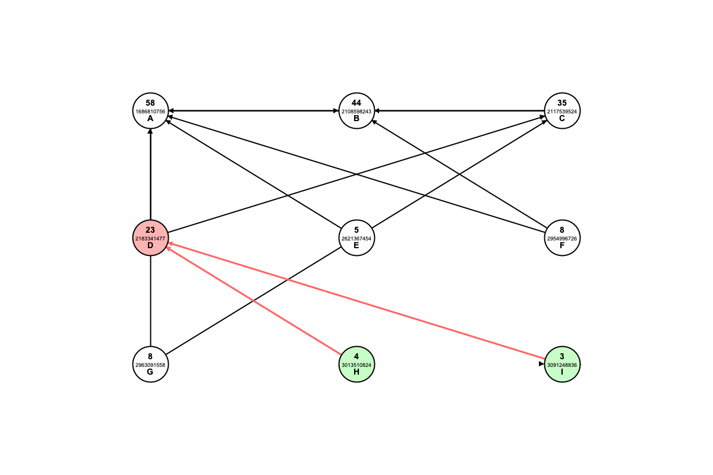

# 🕸️ Citation Graph Explorer

[](https://www.java.com)
[](https://docs.oracle.com/javase/tutorial/uiswing/)
[](https://openalex.org)
[]()

Akademik makaleler arasındaki atıf ilişkilerini **yönlü bir graf** olarak modelleyen; **H-Index**, **Betweenness Centrality** ve **K-Core** analizlerini etkileşimli bir arayüzde sunan Java Swing masaüstü uygulaması.

Harici kütüphane kullanılmaz: JSON ayrıştırıcı, graf yapısı, algoritmalar ve görselleştirme sıfırdan yazılmıştır.

<p align="center">
  
</p>
<p align="center">
  <em>Veri setinde en çok atıf alan makalenin ağı. D düğümüne tıklandığında yeni komşular yeşil, yeni kenarlar kırmızı görünür.</em>
</p>

## ✨ Özellikler

- **Graf istatistikleri:** makale ve referans sayıları, en çok atıf alan ve en çok referans veren makale
- **H-Index, H-Core ve H-Median** hesabı
- **Etkileşimli ağ:** düğüme tıklayarak komşuları grafa ekleme, üzerine gelerek makale bilgilerini görme
- **Betweenness Centrality:** ekrandaki düğümlerin köprü rolünü ölçme
- **K-Core ayrışımı:** seçilen `k` değerine göre yoğun çekirdeği bulma ve vurgulama

## 🚀 Kurulum ve Çalıştırma

Java 11 veya üzeri bir JDK yeterlidir. Komutları proje kök dizininde çalıştırın:

```bash
javac -encoding UTF-8 -d out src/*.java
```

```bash
java -Dfile.encoding=UTF-8 -cp out Main
```

> Arayüz Türkçedir. `-encoding UTF-8` ve `-Dfile.encoding=UTF-8` seçenekleri Türkçe karakterlerin ve makale verilerinin her platformda doğru okunmasını sağlar.

## 🧭 Kullanım

1. **JSON Dosyasını Yükle** ile `data/prolab3_data.json` dosyasını seçin. En çok atıf alan makalenin ID'si otomatik olarak doldurulur.
2. **H-Index Hesapla ve Göster** ile seçili makalenin ağını açın.
3. Ağı büyütmek için düğümlere tıklayın; ayrıntılar için üzerine gelin.
4. İsterseniz bir **K Değeri** girip **Metrikleri Hesapla** düğmesine basın. K alanı boşsa yalnızca Betweenness Centrality hesaplanır.

### Düğümlerin okunuşu

Her düğümde yukarıdan aşağıya atıf sayısı, ID'nin son 10 karakteri ve harf etiketi yer alır. Oklar, referans veren makaleden referans verilen makaleye doğrudur.

| Renk | Anlamı |
|---|---|
| 🔴 Pembe düğüm | Seçili makale |
| 🟡 Sarı düğüm | H-Core üyesi |
| 🟢 Yeşil düğüm | Son genişletmede eklenen makale |
| 🟣 Lila düğüm | K-Core üyesi |
| ⚪ Beyaz düğüm | Diğer makaleler |
| Kırmızı kenar | Son genişletmede eklenen bağlantı |
| Mavi kenar | K-Core içindeki bağlantı |

## 📐 Metrikler

| Metrik | Hesaplama |
|---|---|
| **H-Index** | Makaleye atıf yapan makaleler kendi atıf sayılarına göre sıralanır. En az `h` atıf almış `h` makale bulunan en büyük `h` değeridir. |
| **H-Core** | Bu sıralamadaki ilk `h` makaledir. |
| **H-Median** | H-Core üyelerinin atıf sayılarının medyanıdır. |
| **Betweenness Centrality** | Ekrandaki düğüm çiftleri arasındaki tüm en kısa yollar, tam graf yönsüz kabul edilerek BFS ile bulunur. Her ara düğüme, geçtiği yolların oranı kadar puan verilir. |
| **K-Core** | Yönsüz grafta derecesi `k` değerinin altında kalan düğümler, kalan tüm düğümlerin derecesi en az `k` olana kadar tekrar tekrar silinir. |

> H-Index burada yazar için değil, **tek bir makale** için ve o makaleye atıf yapan çalışmalar üzerinden hesaplanır. Tüm atıf sayıları yalnızca veri seti içindeki atıfları kapsar.

## 📊 Veri Seti

`data/prolab3_data.json`, [OpenAlex](https://openalex.org) kaynaklı ve ağırlıklı olarak bilgisayarlı görü alanındaki makalelerin üst verilerini içerir.

| Özellik | Değer |
|---|---|
| Makale sayısı | 1.000 |
| Veri seti içi atıf (kenar) sayısı | 1.590 |
| Yayın yılı aralığı | 1971 – 2025 |
| En çok atıf alan makale | *Very Deep Convolutional Networks for Large-Scale Image Recognition* (58 atıf) |
| Bu makalenin H-Index / H-Median değeri | 5 / 8,0 |
| En çok referans veren makale | `W3201064488` (21 referans) |

K-Core boyutları:

| k | Düğüm | Kenar |
|---|---:|---:|
| 2 | 501 | 1.403 |
| 3 | 343 | 1.116 |
| 4 | 188 | 701 |
| 5 | 95 | 375 |

Kendi verinizi kullanmak için şu biçimde bir JSON dizisi yükleyebilirsiniz:

```json
[
  {
    "id": "https://openalex.org/W2002615855",
    "doi": "https://doi.org/10.1016/s0260-8774(03)00182-1",
    "title": "Makale başlığı",
    "year": 2003,
    "authors": ["Yazar Adı"],
    "referenced_works": ["https://openalex.org/W2972970334"]
  }
]
```

## 🗂️ Proje Yapısı

```text
├── data/
│   └── prolab3_data.json     # Örnek veri seti
├── docs/
│   └── graph-view.png        # README görseli
└── src/
    ├── Main.java             # Giriş noktası
    ├── GUI.java              # Ana pencere ve kullanıcı akışı
    ├── GraphVisualizer.java  # Grafın çizimi, tıklama ve üzerine gelme olayları
    ├── Graph.java            # Komşuluk listeleri ve H-Index hesapları
    ├── GraphAnalyzer.java    # Betweenness Centrality ve K-Core
    ├── JSONLoader.java       # JSON ayrıştırıcı ve graf oluşturma
    └── Article.java          # Makale modeli
```

## ⚠️ Bilinen Kısıtlar

- Harf etiketleri 26 düğümden sonra `Z` harfinin ötesindeki karakterlere geçer.
- JSON ayrıştırıcısı kaçışlı tırnakları (`\"`) desteklemez. Örnek veri setinde bu durum yoktur.
- Betweenness Centrality tüm en kısa yolları tek tek listelediği için kalabalık ağlarda yavaşlayabilir.
